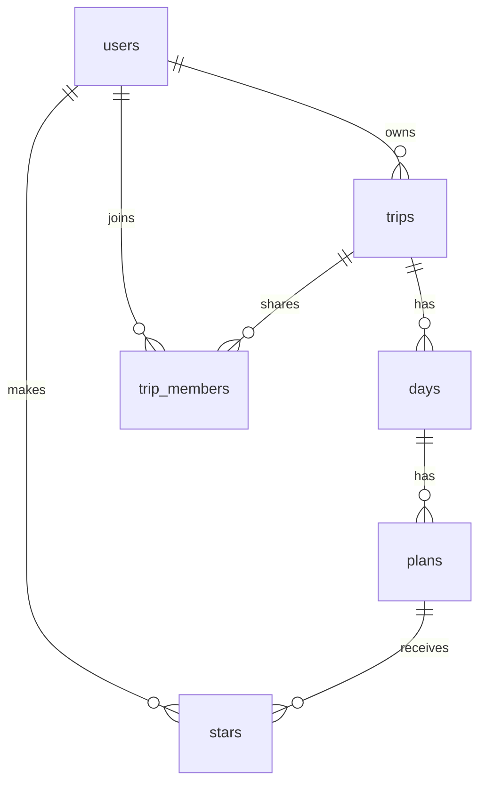

# MiTrip: PLAN

## 1. Pitch

I'm building MiTrip because on my honeymoon (Australia and New Zealand, Jan 8 to 24, 2027) I want to open one app on my phone each morning and find everything I need that day: the itinerary, reservations, tickets, and directions in Google Maps, without digging through email. I can also share a trip with the people joining me so we all follow the same plan. I'll use it while planning my next three trips this semester and then every day during each trip.

## 2. Features (in build order)

**Spine**

1. **Sign up and login.** As a new visitor, I want to create an account with my email and a password, or continue with my Google account, then log in and log out, so that my trips are private to me. Either way, my account is one row in the users table.
2. **Data model.** As a user, I want each trip to hold its days and each day to hold its plans, so that a 17-day honeymoon and a 4-day bachelor party are organized the same way.
3. **Create / read / update / delete.** As a user, I want to add a trip with a name, start date, end date, and an optional Google Maps list link and pasted itinerary; see my list of trips; open a trip's detail page; edit it; and delete it after an "Are you sure?" confirmation, so that I keep my trips current. Creating a trip creates one day for every date from start to end. Inside a day I can add, view, edit, and delete plans the same way (title, type, times, address, confirmation number, ticket link, notes).
4. **Validation.** As a user, I want a clear message when I leave a trip name or date blank, set an end date before the start date, or leave a plan's title or type blank, so that I never save a broken trip.
5. **Stars.** As a user, I want to star plans (a boarding pass, the Milford Sound cruise ticket) and see them all on a Starred page, so that the things I must show at a door are one tap away.
6. **Find things.** As a user, I want to search plans by title or address, filter by type (flight, hotel, reservation, ticket, activity), and sort by date and time or by newest added, so that I can find "that dinner place" fast.
7. **Dashboard.** As a user, I want to see a bar chart of plans per day for a trip, plus three stats (days until my next trip, trips this year, total plans in the trip), so that I can spot overloaded days and see how close the trip is.

**My 3 features**

8. **Trip members (read-only).** As a trip owner, I want to invite a companion by the email they signed up with, so that they can see the trip, its days, plans, and tickets, and star plans for themselves, while only I can edit.
9. **Today view with tomorrow snapshot.** As a traveler, I want the trip to open on today's date with plans in time order, an "Open in Google Maps" button on every plan with an address, and a "Tomorrow" snapshot at the bottom, so that each morning starts with one screen.
10. **Ticket upload.** As a traveler, I want to attach a photo or screenshot of a ticket or QR code to a plan, so that I can show it at the gate even when the email is buried.

**Stretch goals (only after 1 to 10 ship, in this order)**

11. **Gmail scan.** As a user, when I add a trip I want a one-time scan of my Gmail for bookings in those dates, so that reservations show up without retyping.
12. **AI itinerary import.** As a user, I want MiTrip to turn my pasted Claude itinerary into days and plans, so that I don't enter each one by hand.
13. **Offline download.** As a traveler, I want to download a trip to my phone, so that I can use it with no signal in rural New Zealand.

## 3. Database

Six tables. Every trip, day, and plan belongs to one owner; trip_members grants read-only access to other users.

**users**: one row per account.
| Column | Type | Notes |
|---|---|---|
| id | text (uuid) | Primary key, matches the login account |
| email | text | Required, unique |
| display_name | text | |
| created_at | date/time | |

**trips**: a user owns many trips (one-to-many).
| Column | Type | Notes |
|---|---|---|
| id | number | Primary key |
| owner_id | text | Links to users.id, required |
| name | text | Required, e.g. "Australia-NZ Honeymoon" |
| start_date | date | Required |
| end_date | date | Required, on or after start_date |
| theme | text | One of a fixed list of light colors tied to the trip (ocean, sand, forest, sunset, mountain) |
| google_maps_list_url | text | Link to my saved Google Maps list |
| itinerary_text | text | Pasted itinerary from Claude |
| created_at | date/time | |

**days**: a trip has many days (one-to-many).
| Column | Type | Notes |
|---|---|---|
| id | number | Primary key |
| trip_id | number | Links to trips.id, required |
| date | date | Required, unique within a trip |
| greeting | text | e.g. "Get excited!", "Congrats, you landed!" |
| summary | text | Shown as the "Tomorrow" snapshot on the day before |

**plans**: a day has many plans (one-to-many).
| Column | Type | Notes |
|---|---|---|
| id | number | Primary key |
| day_id | number | Links to days.id, required |
| title | text | Required, e.g. "SFO to Sydney" |
| type | text | Required, one of: flight, hotel, reservation, ticket, activity |
| start_time | time | |
| end_time | time | |
| address | text | Builds the Open in Google Maps link |
| confirmation_number | text | Flight number, booking reference |
| ticket_url | text | Boarding pass or Apple Wallet link |
| ticket_image | text | Path to an uploaded ticket image in file storage |
| notes | text | e.g. "Watch 2 or 3 movies, then sleep" |
| created_at | date/time | |

**stars**: junction table; users and plans are many-to-many through it.
| Column | Type | Notes |
|---|---|---|
| user_id | text | Links to users.id |
| plan_id | number | Links to plans.id |
| created_at | date/time | |
Primary key is (user_id, plan_id), so a user can star a plan only once.

**trip_members**: junction table; users and trips are many-to-many through it.
| Column | Type | Notes |
|---|---|---|
| trip_id | number | Links to trips.id |
| user_id | text | Links to users.id |
| role | text | "viewer" for now |
| created_at | date/time | |
Primary key is (trip_id, user_id).

**Who sees what:** a user sees a trip (and its days and plans) only if they own it or are listed in trip_members for it. Only the owner can create, edit, or delete. Each user sees only their own stars.

## 4. Tests

- **Data isolation:** Given User A owns the trip "Australia-NZ Honeymoon" with one plan, and User B is a separate account that is not a member of it, when User B loads their trip list and then opens User A's trip by its direct link, then User B's list is empty and the trip page shows "Trip not found."
- **Dashboard:** Given today is Oct 29, 2026 and a user has trips starting Jan 8, 2027, Jan 28, 2027, and Mar 17, 2027, when the dashboard calculates "days until next trip," then it shows 71.

## 5. Technologies

- **Coding agent: Claude Code in VS Code**, because it works directly in my repo and runs Git and GitHub commands for the feature loop.
- **Framework: Next.js (React, TypeScript)**, because pages and server code live in one project and it deploys to Vercel with no setup.
- **Database: Supabase (Postgres)**, because it is a real relational database with foreign keys and a visual table editor that makes my data model easy to check and explain.
- **Sign up and login: Supabase Auth with email and password, plus "Continue with Google,"** because it handles accounts out of the box, and Google sign-in saves travelers from inventing another password. Google sign-in asks only for name and email (no inbox access). Email confirmation will be off so the live sign-up at Demo Day works instantly.
- **Data privacy: Supabase Row Level Security**, because the database itself enforces "you only see trips you own or are a member of," which is exactly what the isolation test checks.
- **File storage: Supabase Storage**, because ticket images need a private place to live next to the data.
- **Hosting: Vercel**, because it redeploys automatically on every merge to main, so the live URL stays current.
- **Libraries:** Recharts for the bar chart because it is a simple React chart library; Tailwind CSS for styling because it makes a consistent phone-first layout fast; Vitest for tests because it runs quickly and works with Next.js.

## 6. Design

- **Feel:** calm, minimal, easy to read. Phone first: built for one-handed use on a phone during the trip, and still usable on a laptop.
- **Colors:** white and soft gray backgrounds with light blue as the main accent; dark gray text for strong contrast. Each trip gets its own light theme color tied to the place (ocean blue for Australia-NZ, sand for Austin, mountain green for the China trek) that tints its card and header.
- **Style:** large, readable text; rounded cards; one plan per card with an icon for its type; generous spacing; no clutter.
- **Inspiration:** TripIt for function only (one place for every booking, organized by day). I don't like TripIt's visual style. Apple Wallet for the look of ticket and boarding pass cards: clean, glanceable, one tap to show.

## 7. Risks and cuts

- **Least sure I can build:** trip members. Sharing changes the privacy rules for every table, and that is where a data leak could slip in. To lower the risk, members are read-only for now.
- **First to cut if time runs short:** the stretch goals, in reverse order (offline download, then AI import, then the Gmail scan). If I'm still short, ticket upload falls back to ticket links only (the ticket_url field). Google sign-in depends on setting up a Google Cloud project; if that stalls, email and password alone still meet the sign-up requirement.
