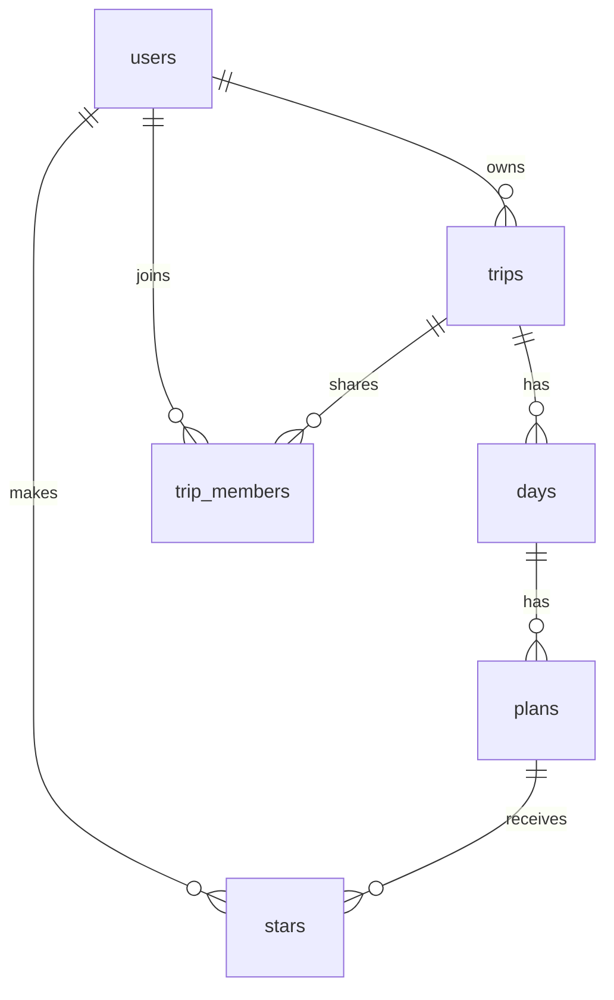

# MiTrip database schema

MiTrip uses a Supabase (Postgres) database with six tables, plus one private file storage bucket for ticket photos. This file describes what is actually in the live database (read from it on Nov 2, 2026), then compares it with the design in [PLAN.md](PLAN.md) section 3.

## How the tables relate

- A **user** owns many **trips** (one-to-many).
- A **trip** has many **days**, one for every date from its start to its end (one-to-many). The database adds the days by itself when a trip is created or its dates change, and removes days that fall outside new dates only if they have no plans, so changing dates never deletes plans.
- A **day** has many **plans** (one-to-many).
- **stars** is the junction table between users and plans (many-to-many): each row means "this user starred this plan."
- **trip_members** is the junction table between users and trips (many-to-many): each row means "this user can view this trip."

Deleting a trip deletes its days, their plans, and those plans' stars. Deleting an account deletes everything that user owns.

## Tables

### users
One row per account, created automatically when someone signs up.

| Column | Type | Notes |
|---|---|---|
| id | uuid | Primary key; the same id as the login account |
| email | text | Required, unique |
| display_name | text | Optional |
| created_at | timestamp | Set automatically |

### trips
| Column | Type | Notes |
|---|---|---|
| id | number | Primary key |
| owner_id | uuid | The user who owns it (links to users.id); set automatically to whoever creates it |
| name | text | Required, can't be blank |
| start_date | date | Required |
| end_date | date | Required, on or after start_date |
| theme | text | One of ocean, sand, forest, sunset, mountain (default ocean) |
| google_maps_list_url | text | Optional link to a saved Google Maps list |
| itinerary_text | text | Optional pasted itinerary, used by the AI import |
| created_at | timestamp | Set automatically |

### days
| Column | Type | Notes |
|---|---|---|
| id | number | Primary key |
| trip_id | number | Links to trips.id |
| date | date | Required; each date appears only once per trip |
| greeting | text | Short line at the top of the day, e.g. "Congrats, you landed!" |
| summary | text | One-sentence preview, shown as the "Tomorrow" snapshot the day before |

### plans
| Column | Type | Notes |
|---|---|---|
| id | number | Primary key |
| day_id | number | Links to days.id |
| title | text | Required, can't be blank |
| type | text | Required: flight, hotel, reservation, ticket, or activity |
| start_time | time | Optional |
| end_time | time | Optional |
| address | text | Optional; builds the "Open in Google Maps" link |
| confirmation_number | text | Optional booking reference or flight number |
| ticket_url | text | Optional link to a boarding pass or ticket |
| ticket_image | text | Optional path to an uploaded ticket photo in the tickets bucket |
| notes | text | Optional |
| created_at | timestamp | Set automatically |

### stars (junction table: users ↔ plans)
| Column | Type | Notes |
|---|---|---|
| user_id | uuid | Links to users.id; set automatically to whoever stars |
| plan_id | number | Links to plans.id |
| created_at | timestamp | Set automatically |

Primary key is (user_id, plan_id), so a user can star a plan only once. All stars for everyone live in this one table.

### trip_members (junction table: users ↔ trips)
| Column | Type | Notes |
|---|---|---|
| trip_id | number | Links to trips.id |
| user_id | uuid | Links to users.id |
| role | text | Only "viewer" is allowed |
| created_at | timestamp | Set automatically |

Primary key is (trip_id, user_id). The table and its privacy rules exist, but the screen to invite someone was not built (see Plan vs. Reality in PLAN.md).

### Ticket photos (file storage, not a table)
A private Supabase Storage bucket named **tickets** holds ticket photos at `<trip id>/<plan id>/<file>`, up to 10 MB each, images only. `plans.ticket_image` stores the path.

## Who can see what (Row Level Security)

The database itself enforces privacy, so a mistake in the app can't leak another user's trip:

- A user sees a trip, its days, its plans, and its ticket photos only if they own it or are listed in trip_members for it.
- Only the owner can create, edit, or delete a trip, its days, its plans, and its ticket photos.
- Each user sees and changes only their own stars, and can only star plans they can see.
- Each user can read only their own row in users.

The data isolation test (`src/lib/data-isolation.test.ts`) checks the first rule.

## Compared with PLAN.md section 3

The agent built what I designed: the same six tables, the same columns, and the same relationships. The differences are small:

| Planned | Built | Why |
|---|---|---|
| ids described as "text (uuid)" and "number" | uuid for user ids, big whole numbers for the rest | Same idea in Postgres terms; user ids must match Supabase login ids, which are uuids |
| Rules described in words ("required", "on or after start_date") | Enforced by the database too: names and titles can't be blank, end date can't be before start date, type and theme must come from their lists, role must be "viewer" | So bad data is refused even if the app's own checks are skipped |
| "Creating a trip creates one day for every date" (section 2) | The database adds the days itself, also when dates change; days outside new dates are removed only if they have no plans | Keeps days in step with the dates without ever deleting plans |
| "Supabase Storage for ticket images" (section 5) | Private **tickets** bucket with the same privacy rules as plans | Built with ticket upload (PR #37) |
| trip_members used by a sharing feature | Table and rules built; invite screen not built | Trip members was cut (see Plan vs. Reality) |
